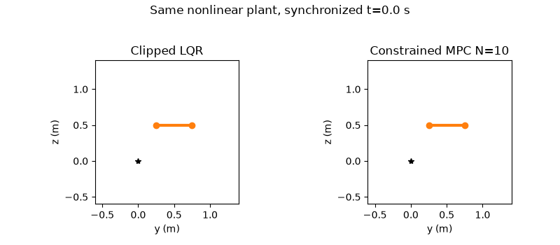
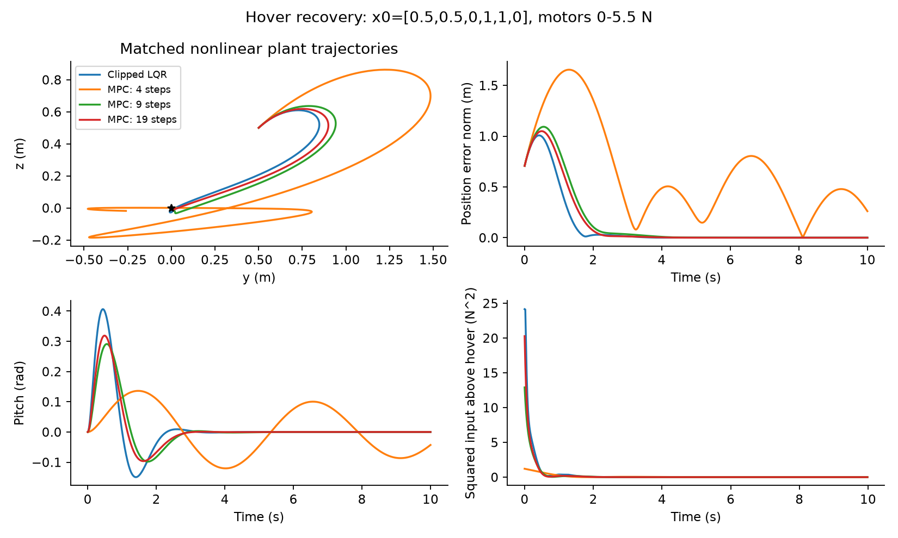
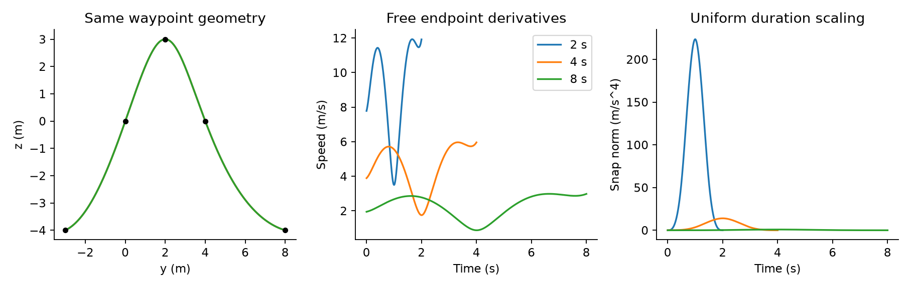

# Robotic Motion Planning and Optimal Control

**Project date:** Fall 2025

Input-constrained MPC for planar quadrotor hover and minimum-snap waypoint planning. An extension of **Penn MEAM 5170 coursework**, with solver implementations, model and simulation corrections, numerical checks, and reproducible experiments using Python, NumPy, SciPy and OSQP.



*Synchronized clipped LQR and MPC N=10 hover recovery: initial state `[y,z,theta,vy,vz,omega]=[0.5,0.5,0,1,1,0]`, fixed target at the origin, and motor limits of 0–5.5 N. Both panels use the same clock and axis limits over 10 simulated seconds. Rendered from saved nonlinear simulation traces.*

[Project page: additional demonstrations and limitations](https://yixiaoliu.me/projects/robotic-motion-planning-optimal-control/) · [Animation settings](docs/DEMONSTRATIONS.md)

## Methods

- **Planar quadrotor:** continuous LQR with actuator clipping versus input-constrained linear MPC on the same nonlinear plant; horizon, cost-weight, disturbance and mass-mismatch studies.
- **Minimum-snap planning:** waypoint interpolation with C4 continuity, a scaled numerical solver, constraint residuals and duration-scaling experiments.

## Representative results

Quadrotor: initial `[0.5,0.5,0,1,1,0]`, 10 s nonlinear simulation, both motors limited to 0-5.5 N. MPC uses .1 s prediction spacing and .02 s control updates. N counts **states**; N=10 has nine input steps. All configurations and unsuccessful trials are retained in the [technical report](docs/ROBOTICS_REPORT.md).



| Method | Position RMSE (m) | Full-state settling (s) | Control effort relative to hover (N² s) |
|---|---:|---:|---:|
| Clipped LQR | 0.2873 | 2.68 | 3.8730 |
| MPC, N=5 | 0.7994 | not settled | 0.8692 |
| MPC, N=10 | 0.3501 | 3.26 | 2.4021 |
| MPC, N=20 | 0.3257 | 2.62 | 2.8863 |

In this scenario, MPC N=10 has **38.0% lower control effort relative to hover**, **21.9% higher position RMSE**, and slower settling than clipped LQR. Control effort is `integral ||u_applied(t) - [4.905,4.905]||² dt` (N² s), a squared-thrust-deviation metric, **not physical energy**.

Continuous infinite-horizon LQR and finite-horizon MPC use different objective and terminal-cost conventions; see the [full comparison audit](docs/ROBOTICS_REPORT.md#cost-conventions-and-comparability). Full-state settling criteria and failure cases are documented in the report.



Doubling minimum-snap trajectory duration from 4 to 8 s reduces integrated squared snap from 210.6954 to 1.6461 (128×). This is geometric waypoint planning with free endpoint derivatives. [Formulation and numerical checks](docs/ROBOTICS_REPORT.md#free-endpoint-nullspace-and-independent-objective-audit).

## Install and run

From the repository root, using Python 3.12 (tested on Windows):

```powershell
python -m venv .venv
.\.venv\Scripts\python.exe -m pip install -r requirements-lock.txt
.\.venv\Scripts\python.exe -m pip install --no-deps -e .
.\.venv\Scripts\python.exe -m control_portfolio.cli robotics-benchmark --output 'outputs/my_benchmark'
.\.venv\Scripts\python.exe -m control_portfolio.cli quadrotor --output 'outputs/my_quadrotor'
.\.venv\Scripts\python.exe -m control_portfolio.cli minsnap --output 'outputs/my_minsnap'
.\.venv\Scripts\python.exe -m pytest -q
```

Choose a fresh output folder for each run. JSON configs, numerical CSV/NPZ traces, solver logs and environment details are exported automatically. [Full reproduction instructions](docs/REPRODUCTION.md) include iLQR, Acrobot, supporting examples, the existing HW3 suite and rebuilding the figures.

Secondary modules cover cart-pole control, unicycle flatness, GridWorld, iLQR, Acrobot collocation and biped OSC. Their [status and limitations](docs/ROBOTICS_REPORT.md#scope-and-status), including unsuccessful optimizations and unverified walking robustness, are documented separately.

## Implementation and coursework

Portfolio extensions include:

- **Solvers:** a portable constrained-MPC QP and a scaled minimum-snap solver for the course formulations.
- **Model and simulation corrections:** corrected quadrotor integration, held-input nonlinear simulation, full-state settling checks, and commanded/applied input logging.
- **Numerical verification:** hover and linearization checks, QP residuals, polynomial continuity, objective/nullspace analysis, and independent integration.
- **Reproducible experiments:** fixed configurations and seeds, numerical exports, and controlled horizon, weight, disturbance, model-mismatch and duration studies.

Original coursework and supplied course frameworks/models remain traceable in Git history and [course_sources](course_sources/README.md). The [HW1-HW6 inventory](docs/ASSIGNMENT_INVENTORY.md) distinguishes existing implementations, supplied infrastructure and new extensions, including attribution for the provided footstep planner.

Explore the [live project page](https://yixiaoliu.me/projects/robotic-motion-planning-optimal-control/) for additional demonstrations. Datasets, source archives, environments and full generated runs are excluded.

[Detailed experimental report](docs/ROBOTICS_REPORT.md) · [Preserved HW3 report](docs/TECHNICAL_REPORT.md) · [Raw numerical summaries](docs/results/robotics)
