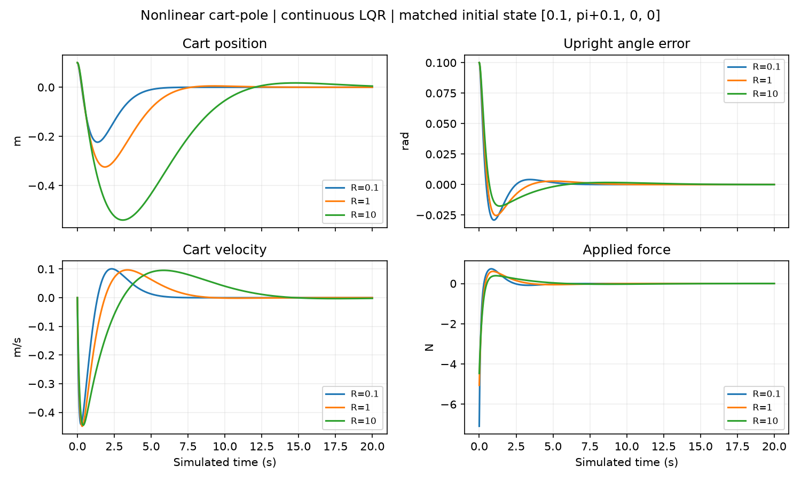
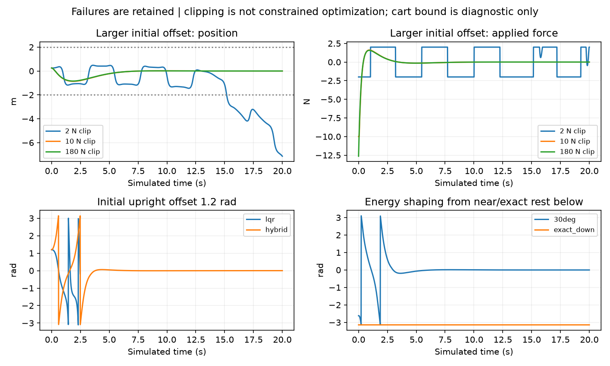
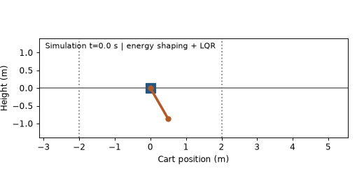
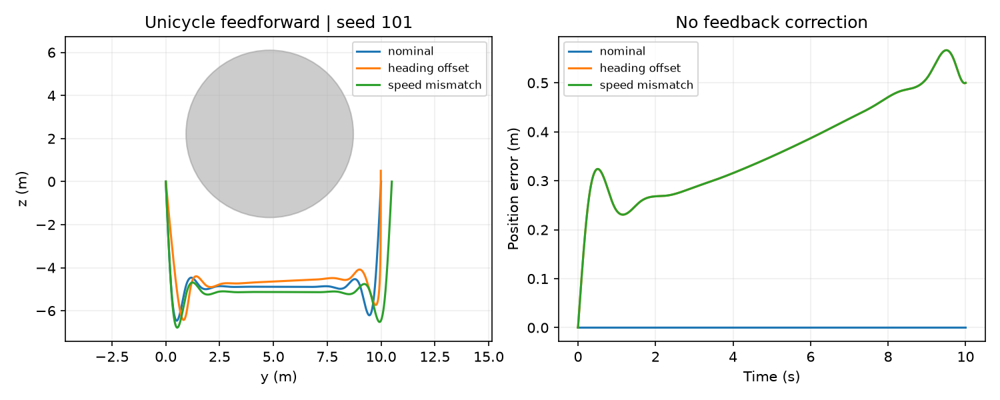

# Nonlinear Control and Flatness-Based Motion Planning

Local reproducibility and experimental extension of the supplied HW3 repository, October 23, 2026. Scope and source limitations are documented in [the audit](AUDIT_AND_PROVENANCE.md). The focused tasks are cart-pole stabilization/swing-up and a smaller unicycle feedforward planning example. MPC and horizon studies are deliberately excluded because no such implementation exists in the source.

## Models and objectives

### Cart-pole conventions and dynamics

State is `[q, theta, v, omega]`, with units `[m, rad, m/s, rad/s]`; input is horizontal force `u` in N. `theta=0` is downward, `theta=pi` is upright; pole endpoint is `(q+L sin(theta), -L cos(theta))`. The system is frictionless and there is no hard rail constraint.

The supplied simulator solves `M [qdd, thetadd]^T = [u,0]^T - C`, with

```text
M = [[mc+mp,        mp L cos(theta)],
     [mp L cos(theta),       mp L^2]]
C = [-mp L sin(theta) omega^2, mp g L sin(theta)]
```

The new explicit two-by-two solve is algebraically identical. Nominal values: mc=mp=1 kg, L=1 m, g=9.81 m/s². Design point is `[0,pi,0,0]` at u=0. Continuous-time Jacobians are

```text
A = [[0, 0,                           1, 0],
     [0, 0,                           0, 1],
     [0, mp*g/mc,                     0, 0],
     [0, (mc+mp)*g/(mc*L),            0, 0]]
B = [0, 0, 1/mc, 1/(mc*L)]^T
```

Finite-difference tests include unequal masses and nonunit length. The supplied velocity coefficient `A[2,2]=1` fails that comparison. Local LQR minimizes the continuous **infinite-horizon**, unconstrained linearized objective integral `(e^T Q e + R u^2) dt`, with `e=[q, wrap(theta-pi), v, omega]`; CARE supplies K and the requested input is `-K e`. Q defaults to diag(1,1,1,10), R=1. Weights scale physical-state penalties; no dimensionless equal-importance interpretation is assumed. No discretized LQR, sampled-data hold, MPC, or finite-horizon optimizer is implemented.

The inherited energy-shaping heuristic uses normalized pole-energy error `Etilde=0.5 omega^2-(g/L)cos(theta)-g/L`, cart acceleration request `a=clip(2 omega cos(theta) Etilde - 1.2 v - 2.5 q, -28,28)`, then partial feedback linearization:

```text
thetadd = -(cos(theta)/L) a - (g/L) sin(theta)
u_request = (mc+mp) a - mp L sin(theta) omega^2 + mp L cos(theta) thetadd
```

Before cart recentering/clipping, the energy term gives `dEtilde/dt=-(omega cos(theta)/L)*a`; this explains its sign, but does not prove global convergence of the complete heuristic. The inherited switching test uses `abs(Etilde)<1` and `wrapped_angle_error^2+omega^2<1`; the latter is a numerical heuristic mixing state units, not a derived optimal switching surface. Force is clipped to the configured ±limit in both modes. This is **clipped unconstrained LQR/energy shaping**, not constrained optimization. Disturbance is an additional external plant force, separate from actuator effort.

### Unicycle

State `[y,z,theta]`; controls `[u1,u2]=[yaw rate rad/s, speed m/s]`, in that order. Dynamics: `ydot=u2 cos(theta)`, `zdot=u2 sin(theta)`, `thetadot=u1`. The original heuristic uses linear y(t) from 0 to 10 in 10 s and a natural cubic z spline through 15 plateau knots on the side opposite the obstacle center. Radius r has a +1 m nominal plateau margin; curvature between knots can overshoot. There is **no optimized objective**, collision certificate, feedback correction, speed bound, or stop-at-goal condition.

Flatness inversion is `u2=hypot(ydot,zdot)` and `u1=(ydot*zddot-zdot*yddot)/(ydot^2+zdot^2+1e-9)`. Positive y derivative keeps the denominator away from zero in these cases. Initial heading is the spline tangent, except in the explicitly perturbed experiments. Obstacle draws are per-instance and seeded, replacing import-time class randomness; the spline recipe itself is preserved.

## Experimental protocol

The full [configuration](../configs/experiments.json), [per-case records](results/results.json), [CSV](results/cartpole_metrics.csv), [summary](results/summary.json), and [environment](results/environment.json) are versioned. Every local run also saves trajectories as NPZ and per-case JSON alongside the config in an ignored, new output directory. Existing output directories are refused rather than overwritten. The original first 59-case sweep remains locally in `outputs/suite_20261023`; the final 60-case sweep, with finer swing-up integration, is `outputs/verified_20261023`.

Cart-pole uses fixed-step RK4, 20 s, dt=0.01 s. Feedback is recomputed at all four RK stages: dt is a numerical integration step, not a controller sampling period. Controller design stays nominal during model-mismatch experiments. Matched cases share initial state, plant, duration, integrator, clipping and metrics except for the stated intervention. R sweep is 0.1/1/10 at two initial states `[0.1,pi+0.1,0,0]` and `[0.25,pi+0.25,0,0]`. Q-angle sweep is 10/100 versus baseline 1, holding the other Q entries and R fixed. Input limits are 2/10/180 N. Basin probes use upright offsets 0.1/0.4/0.8/1.2 rad for LQR and hybrid control. These solve the same upright-regulation task, but hybrid transients can intentionally rotate the pole, so angle RMSE alone is not a sufficient ranking.

Disturbance trials use five seeds 101–105 and a constant force uniformly drawn from [-2,2] N on [5,6) s, paired across R choices. Parameter-mismatch trials use those same pulses with true mp=1.25 kg and L=1.15 m but unchanged nominal controller design. RK4 samples pulse endpoints; small impulse discrepancies are expected at finite dt. Integration checks use dt=.02/.01/.005 for a near-upright LQR case, plus dt=.005 for the 30°-from-down swing-up. Unicycle trials use the same five obstacle seeds for nominal, +0.05 rad initial heading, and ×1.05 forward-speed conditions. solve_ivp uses max_step=.005, rtol=1e-8, atol=1e-10; 2,001 logged times per 10 s run.

An initial 2 s benchmark took about 0.010 s and projected about 6.1 s for 59 twenty-second cart-pole simulations, excluding CARE, unicycle and plotting. The complete final suite of 60 cart-pole and 15 unicycle cases took **30.34 s** locally, excluding figure generation. Exact dependency versions are in [requirements-lock.txt](../requirements-lock.txt). These are wall-clock simulation measurements, not real-time execution guarantees or hardware deployment results.

## Metric definitions

- Cart RMSE: sqrt(mean(q²)); angle RMSE: sqrt(mean(wrap(theta-pi)²)), over the whole completed rollout.
- Final errors: absolute last-sample cart/angle errors. State units are not mixed into one aggregate score.
- Settling time: earliest logged time after which **every remaining sample** satisfies |q|≤.05 m, |angle error|≤.05 rad, |v|≤.1 m/s, |omega|≤.1 rad/s; at least 1 s must remain. Null means not settled within this evaluation.
- Effort: trapezoidal integral of applied actuator u², in N²s. Peak force is max sampled |u|. External disturbance is excluded.
- Requested exceedance, applied violation and clipping fractions are sampled-grid fractions, not continuous-time guarantees. The ±2 m cart bound is diagnostic only and is not enforced in dynamics.
- Unicycle position RMSE: sqrt(mean(||position-reference||²)); clearance is sampled center distance minus obstacle radius. No collisions at logged samples do not certify continuous clearance or general obstacle avoidance.
- A nonfinite state, |cart|>50 m or velocity-vector norm>150 triggers a numerical/safety stop. Stopped runs are marked failures and do not receive misleading full-duration RMSE/effort scores; their finite traces are retained.

## Main measured findings

### Local regulation and weights

Matched initial state `[0.1,pi+0.1,0,0]`, Q=diag(1,1,1,10), 180 N clip, no disturbance:

| R | Cart RMSE (m) | Settling (s) | Effort (N²s) | Peak force (N) |
|---|---:|---:|---:|---:|
| 0.1 | 0.0647 | 3.64 | 2.895 | 7.090 |
| 1 | 0.1142 | 5.65 | 2.405 | 5.054 |
| 10 | 0.2505 | 10.11 | 2.112 | 4.465 |

Lower R trades faster settling and smaller cart error for larger peak input and nominal effort. This ranking is not universal: under paired disturbances, mean effort need not decrease with R. With R=1, increasing only Q_theta from 1 to 100 slightly reduces angle RMSE from 0.01172 to 0.01142 rad but increases settling from 5.65 to 5.85 s and peak force from 5.054 to 5.248 N in this case. Penalizing one state does not guarantee all-state improvement.



Five paired force-pulse seeds, same small initial offset (mean ± sample SD):

| R | Cart RMSE (m) | Settling (s) | Effort (N²s) |
|---|---:|---:|---:|
| 0.1 | 0.0800 ± 0.0106 | 8.78 ± 0.55 | 5.56 ± 2.00 |
| 1 | 0.1700 ± 0.0368 | 11.21 ± 0.58 | 6.17 ± 2.85 |
| 10 | 0.4055 ± 0.1186 | 15.75 ± 0.81 | 6.37 ± 3.14 |

The mass/length mismatch cases remain completed and settled for these five tested pulses. This is a small scenario sweep, not a robustness certificate. Full values, including final errors, are in the raw records.

### Correction is mathematical, not universal performance dominance

For the small initial offset, the SciPy reimplementation of legacy A settles in 9.46 s versus 5.65 s for corrected A, and has 20 s final cart error 0.01475 m versus 0.0000182 m. However, its whole-trajectory cart RMSE is lower (0.0654 vs 0.1142 m). Correcting the Jacobian is justified by the equations and finite differences, not by claiming every metric improves. The original Drake environment was not executed.

### Limits, basin and swing-up failures

At initial `[.25,pi+.25,0,0]`, the 2 N clipped LQR does not settle: final cart error is 7.138 m, force is clipped at about 97.45% of logged samples, and the diagnostic ±2 m bound is exceeded at about 24.14% of samples. At 10 N, it settles in 6.55 s; at 180 N, 6.52 s. Applied-force violations are zero at logged times for all audited cases. Clipping limits force, not state excursions.

For a 1.2 rad initial upright offset, standalone LQR hits the safety stop; the inherited hybrid policy settles in 9.71 s. This is one tested initial state, not a global basin estimate. Starting 30° from downward, hybrid control settles in 9.84 s but temporarily exceeds ±2 m cart travel; it is not a rail-constrained solution. Exactly stationary downward is an invariant zero-input state of this energy-shaping law and **never swings up**. Adding a kick to hide that limitation was deliberately avoided. Equivalent 30°+2pi initialization gives the same audited response after angle wrapping.



Wrapped-angle plot jumps at ±pi are coordinate representation changes, not discontinuities of physical motion. Stopped LQR traces end early. For swing-up, halving dt changes settling from 9.840 to 9.835 s and produces maximum aligned-grid state-vector disagreement 0.00415 (mixed units, diagnostic only); peak force changes from 64.61 to 64.73 N. For local LQR, dt=.01 versus .005 changes settling by .005 s and effort by about 0.08%; sample-grid RMSE also changes slightly. These finite checks support the reported resolution, not exhaustive numerical convergence of all trajectories.



Animation spans 20 simulated seconds in 40 frames at 10 fps (accelerated playback). Dotted cart bounds are diagnostics, not barriers.

### Unicycle: good nominal inversion is not robust tracking

Across five obstacle seeds, nominal mean position RMSE is 0.00000385 m and mean endpoint error 0.00000891 m under the exact simulated model and tangent-aligned initialization. A +0.05 rad heading offset raises mean RMSE to 0.3521 m and mean endpoint error to 0.49995 m; a +5% speed mismatch gives 0.3521 m and 0.50000 m. The endpoint rotation/scale errors agree with open-loop geometry. All 15 logged trajectories have positive sampled clearance, but only five obstacles and sampled collision checks were tested.



The spline can demand up to **22.50 m/s** and **36.39 rad/s** in these samples. It also has nonzero terminal speed; it passes through the endpoint rather than stopping there. These are significant limitations for physical robots. No actuator-bounded trajectory optimization or feedback tracker is claimed. The larger unicycle RMSE is a different task/metric from cart-pole regulation and is not compared as controller superiority.

## Reproduction and deliverables

See [README](../README.md) for installation and CLI commands. The suite creates a new directory with full configuration, numeric traces, gains, metrics, and environment. `scripts/build_portfolio.py --run <directory>` exports curated figures and small result records to docs; it does not run simulations. The six meaningful tests check finite-difference Jacobians, CARE residual/stability, partial feedback linearization, wrapping/clipping, flatness inversion and RK4 versus tight adaptive integration.

Remaining gaps: full assignment and pristine framework are unavailable; original Drake behavior is not directly verified; only a small set of plants, initial states and seeded force pulses is tested; hard cart-rail constraints, unicycle actuator constraints, feedback tracking, MPC and finite-horizon optimization are absent. No new algorithms, real-world deployment, or certified real-time performance is asserted. Public redistribution conditions need course-specific confirmation; the repository remains private and changes are local only.
